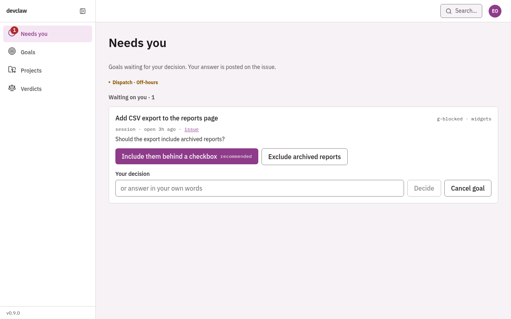
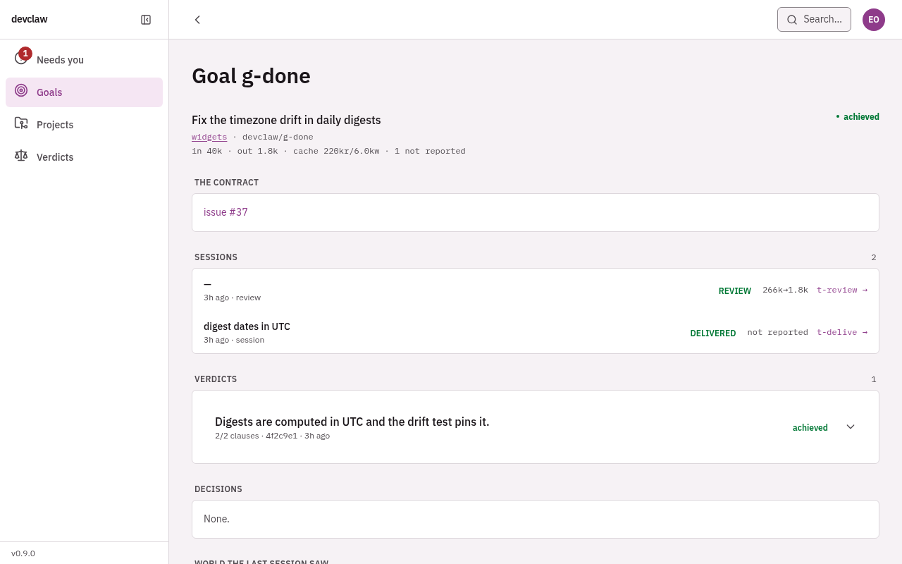
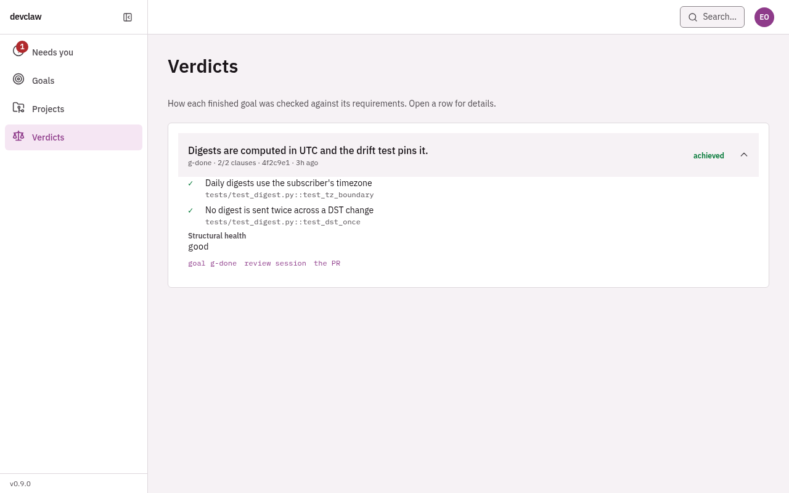

# devclaw: case study and evidence

What devclaw is, what it delivered, what failed, and what it costs to run.
Every claim links to a record in a public repository. Written 2026-10-21, after
the re-cut ([#961](https://github.com/lifekit-hq/devclaw/issues/961), [#964](https://github.com/lifekit-hq/devclaw/issues/964), [#965](https://github.com/lifekit-hq/devclaw/issues/965)) landed on `main`.

## What makes it distinct

**devclaw decides whether a goal is actually done: a fresh read-only review
session judges the repository against the issue's own `## Done when` clauses,
and Python checks that verdict clause by clause before it squash-merges,
instead of trusting the agent's word or waiting for a human to click merge.**

The rest supports that sentence. Python holds what is determined: the tick, the
world fingerprint, the quota pause, the single-writer store and the verdict
check. The model does what needs reasoning: planning the repository's own way,
writing the increment and reviewing it. The design is
[`specs/046-devclaw-v2/spec.md`](../specs/046-devclaw-v2/spec.md). The verdict
check is [`devclaw/goal/donegate.py`](../devclaw/goal/donegate.py). The
mechanics are in [`architecture.md`](./architecture.md#the-done-gate).

## The console

Captured on 2026-10-21 from the hosted demo,
[lifekit-hq.github.io/devclaw](https://lifekit-hq.github.io/devclaw/) ([#963](https://github.com/lifekit-hq/devclaw/issues/963)),
at 1280×800. The demo runs on invented fixture data and sends nothing.

**Needs you.** The owner's one job is a decision. A goal that stopped on a
question shows its options, and the answer is posted on the issue.



**A goal.** The contract is the issue. Each session and the review that judged
it are listed, with token counts.



**Verdicts.** Every done-gate review, clause by clause, with the test that
proves each clause.



## Delivered PRs

These PRs were opened by devclaw and merged in public repositories. Each one
passes all three checks below. All three can be read from GitHub alone.

1. **The `devclaw` label.** devclaw's delivery attached this label to every PR
   it opened. The code landed in [#510](https://github.com/lifekit-hq/devclaw/issues/510) (2026-08-13) and was replaced by the
   no-mistakes hand-off in [#964](https://github.com/lifekit-hq/devclaw/issues/964).
2. **A goal branch.** The head branch is `goal/<goal-id>`, the branch devclaw
   creates for each goal.
3. **Worker commits only.** Every commit on the branch was authored by the
   worker's own git identity (`Claude Agent <agent@devclaw>` or `devclaw <…>`).
   No human commits are on the branch. This is the v0.1 promise's own test for
   rework (below). Its second test, a follow-up fix within 48 hours, is not
   checked here.

| Repo | PR | Merged | Title as delivered | Commits | Lines |
|---|---|---|---|---|---|
| devclaw | [#924](https://github.com/lifekit-hq/devclaw/pull/924) | 2026-09-15 | fix(runner): report the gate's real verdict on the event stream | 4 | +362 / −73 |
| devclaw | [#851](https://github.com/lifekit-hq/devclaw/pull/851) | 2026-09-07 | merge: bring spec 038 up to the default branch head | 4 | +1149 / −37 |
| devclaw | [#828](https://github.com/lifekit-hq/devclaw/pull/828) | 2026-09-06 | fix(doctor): never judge a project from devclaw's own checkout | 3 | +413 / −20 |
| devclaw | [#800](https://github.com/lifekit-hq/devclaw/pull/800) | 2026-09-03 | merge: bring spec 031 (Problems/Decisions) into the spec 030… | 10 | +2115 / −91 |
| devclaw | [#730](https://github.com/lifekit-hq/devclaw/pull/730) | 2026-08-29 | test(brief): strengthen budget tests to force compaction and pin R5 | 2 | +318 / −4 |
| devclaw | [#723](https://github.com/lifekit-hq/devclaw/pull/723) | 2026-08-28 | feat(dispatch): issue-keyed companion dispatch — spec 022 US1 | 1 | +962 / −5 |
| devclaw | [#698](https://github.com/lifekit-hq/devclaw/pull/698) | 2026-08-26 | fix(goal): auth-pause ping names the exact credential path and… | 1 | +109 / −8 |
| devclaw | [#697](https://github.com/lifekit-hq/devclaw/pull/697) | 2026-08-26 | chore: mark increment 3 tasks complete in tinyspec | 3 | +496 / −87 |
| devclaw | [#696](https://github.com/lifekit-hq/devclaw/pull/696) | 2026-08-25 | feat(console): eval-outcome + cycle-report row drill-ins (issue [#682](https://github.com/lifekit-hq/devclaw/issues/682)… | 1 | +500 / −55 |
| devclaw | [#589](https://github.com/lifekit-hq/devclaw/pull/589) | 2026-08-22 | feat: Build the instance usage surface described in issue… | 2 | +985 / −1 |
| finance-sentry | [#627](https://github.com/lifekit-hq/finance-sentry/pull/627) | 2026-09-15 | fix(research): stop a failed quote-cache write poisoning the thesis save | 1 | +898 / −45 |
| finance-sentry | [#612](https://github.com/lifekit-hq/finance-sentry/pull/612) | 2026-09-15 | feat(scanner): gate the widened scan's alerts and prove the funnel end… | 12 | +3484 / −188 |
| finance-sentry | [#605](https://github.com/lifekit-hq/finance-sentry/pull/605) | 2026-09-09 | refactor(554): one key seam and a race-safe write behind committed pins | 4 | +1836 / −58 |
| finance-sentry | [#602](https://github.com/lifekit-hq/finance-sentry/pull/602) | 2026-09-08 | feat(554): widen committed outflow to rent, loans and counterparty… | 1 | +692 / −68 |
| finance-sentry | [#601](https://github.com/lifekit-hq/finance-sentry/pull/601) | 2026-09-07 | refactor(553): one ordered categorization ladder on every ingest path | 2 | +1448 / −89 |
| finance-sentry | [#588](https://github.com/lifekit-hq/finance-sentry/pull/588) | 2026-09-08 | feat(research): re-probe retired news sources so retirement is not… | 1 | +725 / −61 |

**How this was counted.** These are 16 of the 48 merged PRs that pass checks 1
and 2 (22 in devclaw, 26 in finance-sentry). The other 32 have at least one
commit under a human identity. That commit was either a hand fix or a worker
commit made before the worker had its own git identity. The record cannot tell
the two apart, so none of the 32 are counted. To reproduce the list:

```bash
gh pr list -R lifekit-hq/<repo> --state merged --label devclaw --limit 100 \
  --json number,headRefName,mergedAt
gh api repos/lifekit-hq/<repo>/pulls/<n>/commits --jq '.[].commit.author'
```

**What the list does not show.**

- Every PR above came from the pre-re-cut engine: an ACP worker in a docker
  sandbox, under the v1 goal layer until 2026-09-13 and the v2 goal layer after
  it.
- The current engine is `claude -p` in a treehouse worktree, shipping through
  no-mistakes. It has not yet delivered a real PR. [#961](https://github.com/lifekit-hq/devclaw/issues/961) records that check as
  untested.
- Some titles read badly, for example `merge: bring spec 038 up…`. Delivery
  titled a goal PR after its latest increment, not after its most important
  one ([#823](https://github.com/lifekit-hq/devclaw/issues/823)). The no-mistakes hand-off now writes the title.

## The v0.1 result: not achieved

**The promise** ([#178](https://github.com/lifekit-hq/devclaw/issues/178), 2026-07-09): a bounded ticket produces a PR that is
merged without rework at least 6 times in 10, over 10 real tickets across two
or more projects, with at most 2 failures caused by the harness.

**What happened.** The proof was never run as designed. [#178](https://github.com/lifekit-hq/devclaw/issues/178) was closed on
2026-07-22 as superseded by a "clean nights" measure. An audit
reopened the question on 2026-07-28 ([#406](https://github.com/lifekit-hq/devclaw/issues/406)): the work being built sat on a proof
that had never been run. That issue was closed on 2026-08-10 in favour of
reading the result from nightly scorecard data. A "measured 5/5" figure in
the README was not that proof, and [#413](https://github.com/lifekit-hq/devclaw/issues/413) flagged it as overstated.

**The nearest measurement** is the scorecard of 2026-09-05, committed in [#832](https://github.com/lifekit-hq/devclaw/issues/832)
and removed with the v1 goal layer in [#909](https://github.com/lifekit-hq/devclaw/issues/909). You can read it at
[`9e277a2:docs/audits/2026-09-05-scorecard.html`](https://github.com/lifekit-hq/devclaw/blob/9e277a2/docs/audits/2026-09-05-scorecard.html).
It shows 1 of 3 checks passing:

| Check (bar set 2026-08-25) | 7 days | 30 days | Result |
|---|---|---|---|
| Decided-merge rate ≥ 0.80 | 1.00 (17 of 17) | 0.94 (32 of 34) | pass |
| First-pass convergence ≥ 0.70 | 0.36 (5 of 14 goals) | 0.29 | **fail** |
| 14 nights without a mechanism wedge | 2 of 5 clean | 9 of 22 clean | **fail** |

In the same 30 days: 314 of 408 tasks finished, 9 goals were abandoned, the
owner steered 47 times, and a goal took a median of 2 review rounds to close
(the worst took 12). In the last week, 14 commits were made by hand on goal
branches.

**The verdict.** The PRs that reached a decision were good enough to merge.
Getting there took too many review rounds and too much help from the owner, and
the loop did not survive two clean weeks of nights. Unattended running over
many nights was never proven, and this page does not claim it.

## Lessons

1. **The mechanism became the product.** Between 2026-07-13 and 2026-09-13 the
   goal layer grew from 350 to 17,022 lines: typed block kinds, heal budgets,
   holds and counters. Each one copied a fact that GitHub or CI already held,
   and each copy drifted. By then about 27 fix commits a week were landing, and
   the rate was rising. v2 ([#909](https://github.com/lifekit-hq/devclaw/issues/909)) rebuilt the goal layer from an empty package.
   The host now stores goals, decisions, the quota pause and one world
   fingerprint per goal, and `tests/test_goal_layer_stays_readable.py` fails
   the build above 1,500 lines.
2. **Bad nights came from the harness, not the model.** None of the five
   wedged nights in the scorecard's fourteen-night strip was caused by the
   model. The causes
   were the loop's own mechanisms and its environment: the dispatch cap being
   reached (three nights), a tracked machine-state file causing merge
   conflicts, and a container recreated with blank credentials ([#816](https://github.com/lifekit-hq/devclaw/issues/816)). In the
   same weeks a provider outage was charged to a goal as if the goal had failed
   ([#817](https://github.com/lifekit-hq/devclaw/issues/817)). In a failure autopsy, look for an environment cause first.
3. **Home-built gates misfire on honest work.** The change-class gate could not
   accept an in-scope `package.json` edit ([#895](https://github.com/lifekit-hq/devclaw/issues/895)). The test-integrity gate could
   not tell faked green tests from tests removed together with their feature
   ([#594](https://github.com/lifekit-hq/devclaw/issues/594)). Liveness was a 30-minute timer instead of evidence ([#766](https://github.com/lifekit-hq/devclaw/issues/766)). The
   re-cut replaced the worker, the sandbox and the gates with single-purpose
   tools: `claude -p`, a
   [treehouse](https://github.com/kunchenguid/treehouse) worktree per goal,
   and [no-mistakes](https://github.com/kunchenguid/no-mistakes) for review,
   tests, push and PR. Python under `devclaw/` and `runner/` went from 13,162
   lines before [#961](https://github.com/lifekit-hq/devclaw/issues/961) to 7,869 on `main` after [#966](https://github.com/lifekit-hq/devclaw/issues/966).
4. **A judge needs its own calibration set.** In the scorecard week the review
   found "concerns" in 50 of 63 structural grades. Without an eval set, nobody
   could tell a strict judge from a broken one. Done-gate churn caused the
   failed first-pass check: the criteria drifted between rounds against the
   same contract.
5. **Keep the part nobody else has.** The re-cut spike ([#959](https://github.com/lifekit-hq/devclaw/issues/959),
   [`spikes/no-mistakes-done-when.md`](./spikes/no-mistakes-done-when.md))
   found that no-mistakes' review flags unmet `## Done when` clauses. It gives
   no per-clause evidence for the met ones, and it judges by reading code, not
   by running it. So the done-gate stayed ([#965](https://github.com/lifekit-hq/devclaw/issues/965)). Its verdict counts only for
   the head it read, and the merge is pinned to that head.

## What it costs

- **Cognition is a Claude subscription, not an API key.** Every session runs
  the `claude` CLI logged in with a Pro or Max plan over OAuth.
  `ANTHROPIC_API_KEY` and `ANTHROPIC_AUTH_TOKEN` are on a refused list in
  [`devclaw/credentials.py`](../devclaw/credentials.py) and are stripped from
  every session's environment, so a stray key is never billed. There is no
  per-token bill. The cost is the plan you already pay for and its usage
  limits.
- **Usage limits pause the loop instead of failing it.** A quota, auth or
  provider-outage failure pauses the account, keeps the work and resumes it
  after the reset ([`devclaw/loom/limits.py`](../devclaw/loom/limits.py)).
- **The brakes are on the spend, not on the bill.** An unchanged world spawns
  no session (`tests/test_goal_tick.py`). `DEVCLAW_GOAL_SESSIONS_PER_DAY`
  (default 8) caps the sessions per goal per UTC day, and
  `DEVCLAW_MAX_CONCURRENT` (default 1) caps how many run at once
  ([`reference/env-vars.md`](./reference/env-vars.md)).
- **Measured usage.** On the 2026-09-05 scorecard a merged PR used about 29k
  tokens over 7 days and about 60k over 30 days, all drawn from the
  subscription's quota. The console shows each goal's token counts. No dollar
  figure is published here, because no metered price applies.
- **Everything else is free tooling.** treehouse and no-mistakes are
  MIT-licensed. The host is any machine that can run Python, git and the
  `claude` CLI.

No fixed benchmark exists in this repository yet, so this page publishes no
benchmark number.
